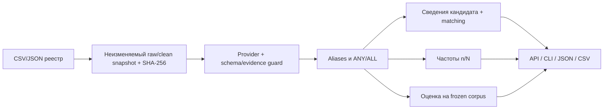

# JobIntel AI

Требования вакансий и пробелы кандидата с проверяемыми источниками: исходный snapshot,
точная цитата, отдельный extraction run, сохранённая candidate revision и честные n/N.
Локальный FastAPI/CLI и веб-интерфейс; fixture, Responses emulator и настоящая CPU-модель
имеют разные execution labels. Статус работы — в [issues](https://github.com/newdarwindev/JobIntelAI/issues).

## Запуск

Нужны Python 3.11+ и GNU Make; полные проверки используют Linux x86_64, Docker Compose,
Node 22+, Chromium/FFmpeg. CPU-режим требует 8 GiB RAM и 20 GiB диска.

```bash
make setup
make demo
make serve
```

Откройте <http://127.0.0.1:8000/ui/> и загрузите синтетический корпус.
`demo` мигрирует отдельную временную SQLite и пишет результаты в ignored
`results/generated/demo`; `serve` создаёт собственный синтетический sandbox и удаляет
его при выходе. Обычный `.venv/bin/uvicorn jobintel.api:app` использует настроенную БД без demo/reset routes;
перед ним выполните явный `make migrate`. Настройки — в [.env.example](.env.example),
приложение читает экспортированные переменные, а не загружает `.env` автоматически.

## Команды

`make help` — назначение целей; `make <цель> ARGS='--help'` — параметры инструмента.
Составные процедуры реализованы в Python и переиспользуют существующие drivers.

| Задача | Вызов |
| --- | --- |
| Все проверки с собственной временной PostgreSQL | `make check-postgres` |
| Python-проверки, PostgreSQL optional | `make check` |
| Wheels для offline образа (Linux x86_64/Python 3.12) | `make prepare-offline` |
| Одноразовый emulator, endpoint передаётся команде в JOBINTEL_ENVIRONMENT | `make env ARGS='run --mode emulator --acquisition -- python my_check.py'` |
| Явная persistent session, project/endpoint печатается JSON | `make env ARGS='up --persistent --mode emulator'` |
| Status / stop / start / scoped reset | `make env ARGS='status --project PROJECT'` (замените action) |
| Сценарий emulator и diagnostics без ручного поиска порта | `make emulator-scenario PROJECT=PROJECT SCENARIO=quota` |
| Authored acquisition/TLS/proxy smoke | `make acquisition-check` |
| Подготовка проверенных весов / реальный CPU smoke | `make model-prepare` / `make model-check` |
| Frozen reviewed fixture experiment и saved rescore | `make experiment-replay ARGS='--output local_data/experiments/new-run'` |
| Русские таблицы из сохранённых результатов | `make reports` |
| Browser dependencies / полный suite и свежие записи | `make ui-install` / `make ui-check` |

У reviewed replay пять unsupported cases на config: report сохраняется, exit code 1 ожидаем
как честный результат ошибок, а не успех. Output должен быть новым. Audit/publish/resume
и B/C используют существующие подкоманды через make; [методика](docs/evaluation.md)
определяет границы и отдельное разрешение на hosted расходы.
Public acquisition smoke выбирается явно через `make acquisition-public-check`, требует
разрешённого direct-egress host; ordinary checks используют только authored local services.
`--offline` требует подготовленных wheels/весов; `--ca-bundle` принимает combined CA.
В managed runtime сохраняйте inherited proxy/CA и проверку TLS. `make model-prepare ARGS='--offline'`
проверяет уже подготовленный cache. Stop/reset окружений не удаляют общие веса.
Если локальный Chromium уже установлен, `UI_BROWSER_PATH=/usr/bin/chromium make ui-check`
выбирает его; это не меняет browser identity в manifest. Путь к Python задаёт `PYTHON`.

## Архитектура и один trace



В SYN-01 «Python is required.» сохраняется точной цитатой с `[start:end]` в Unicode;
«Postgres is nice to have.» — PREFERRED и alias PostgreSQL. У синтетического кандидата
Python COVERED, отсутствующий PostgreSQL в неполном профиле UNKNOWN. AWS OR Azure
остаётся одной ANY-группой. После demo Python встречается в 5/20 вакансий; это выбранный
корпус, не рынок труда. Точный span ещё не доказывает семантическую правильность.

## Результаты и границы

[Русский каталог измерений](results/README.md) связывает таблицы с исходными JSON/audits.
Fixture raw/normalized alignment — 18/22 и 22/22: это pipeline regression, не качество LLM.
Реальная CPU-модель имеет сохранённые ошибки и пропуски; token/cost/time нельзя выдумывать.

API не аутентифицирован и работает только на loopback. Private вакансии, candidate history,
переписка/секреты — в ignored local_data либо вне Git. Public URL не означает право на
перепубликацию. [Контракты и ограничения](docs/specification.md), [правила работы](AGENTS.md),
[UI-приёмка](docs/web_ui_spec.md), [исходный brief](docs/source_brief.txt).
Полный перечень API/полей доступен в локальном `/docs`; команды — `.venv/bin/jobintel --help`.

## Успешные записи desktop/mobile

<!-- UI-RECORDINGS:START -->

Успешные браузерные попытки: **28/28**, записано 2026-10-20.
Источник: [Запуск GitHub Actions](https://github.com/newdarwindev/JobIntelAI/actions/runs/39440475953) · коммит `e30c2f4667edd14970f843fa15bd7a0811ff2945`.
UI01–UI08 и UI12–UI14: синтетический sandbox; UI12 проверяет drafts при задержке реальных ответов, UI13 — durable mutation recovery, UI14 — частичные batches и безопасное продолжение. UI09–UI11: PostgreSQL API, fixture, Responses emulator и реальная CPU inference. Ввод авторский; emulator подтверждает только контракт.
SHA-256 исходного содержимого: `dc134a9714a84967c0e4ac05fe13dc7a32deda88049ea185f0b7599d84cbd5b5`. [Машинные данные происхождения](docs/ui-recordings/manifest.json).

[Измеренные исходы batches](docs/issue-evidence/41/batch-comparison.md) · [JSON наблюдений batches](docs/issue-evidence/41/batch-comparison.json).

[Измеренное восстановление mutations](docs/issue-evidence/40/mutation-comparison.md) · [JSON наблюдений](docs/issue-evidence/40/mutation-comparison.json).

| Полный сценарий | Desktop Chromium | Mobile Chromium |
| --- | --- | --- |
| UI01 · Атомарный импорт реестра и поиск | [Смотреть](docs/ui-recordings/UI01-desktop-chromium.webm) | [Смотреть](docs/ui-recordings/UI01-mobile-chromium.webm) |
| UI02 · Получение источника, ручное восстановление и история | [Смотреть](docs/ui-recordings/UI02-desktop-chromium.webm) | [Смотреть](docs/ui-recordings/UI02-mobile-chromium.webm) |
| UI03 · Извлечение с цитатами, aliases и операторы | [Смотреть](docs/ui-recordings/UI03-desktop-chromium.webm) | [Смотреть](docs/ui-recordings/UI03-mobile-chromium.webm) |
| UI04 · Свидетельства кандидата и четыре состояния matching | [Смотреть](docs/ui-recordings/UI04-desktop-chromium.webm) | [Смотреть](docs/ui-recordings/UI04-mobile-chromium.webm) |
| UI05 · Срезы корпуса, пробелы и безопасный экспорт | [Смотреть](docs/ui-recordings/UI05-desktop-chromium.webm) | [Смотреть](docs/ui-recordings/UI05-mobile-chromium.webm) |
| UI06 · Диагностика fixture и source-reviewed оценки | [Смотреть](docs/ui-recordings/UI06-desktop-chromium.webm) | [Смотреть](docs/ui-recordings/UI06-mobile-chromium.webm) |
| UI07 · Восстановление после provider/connection failure | [Смотреть](docs/ui-recordings/UI07-desktop-chromium.webm) | [Смотреть](docs/ui-recordings/UI07-mobile-chromium.webm) |
| UI08 · Клавиатура, readiness, адаптивность и безопасный ввод | [Смотреть](docs/ui-recordings/UI08-desktop-chromium.webm) | [Смотреть](docs/ui-recordings/UI08-mobile-chromium.webm) |
| UI09 · Обычный PostgreSQL fixture pipeline и неподдержанный ввод | [Смотреть](docs/ui-recordings/UI09-desktop-chromium.webm) | [Смотреть](docs/ui-recordings/UI09-mobile-chromium.webm) |
| UI10 · Обычный PostgreSQL Responses pipeline и история ошибок | [Смотреть](docs/ui-recordings/UI10-desktop-chromium.webm) | [Смотреть](docs/ui-recordings/UI10-mobile-chromium.webm) |
| UI11 · Обычный PostgreSQL CPU inference, оценка и восстановление | [Смотреть](docs/ui-recordings/UI11-desktop-chromium.webm) | [Смотреть](docs/ui-recordings/UI11-mobile-chromium.webm) |
| UI12 · Несохранённые drafts при навигации и поздних ответах | [Смотреть](docs/ui-recordings/UI12-desktop-chromium.webm) | [Смотреть](docs/ui-recordings/UI12-mobile-chromium.webm) |
| UI13 · Восстановление сохранённых mutations без повторного исполнения | [Смотреть](docs/ui-recordings/UI13-desktop-chromium.webm) | [Смотреть](docs/ui-recordings/UI13-mobile-chromium.webm) |
| UI14 · Частичные batches и ограниченное продолжение | [Смотреть](docs/ui-recordings/UI14-desktop-chromium.webm) | [Смотреть](docs/ui-recordings/UI14-mobile-chromium.webm) |

<!-- UI-RECORDINGS:END -->
