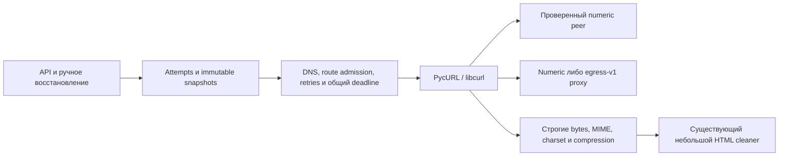

# Замена HTTP transport на libcurl

Production acquisition использует PycURL 7.48.0; libcurl владеет HTTP framing,
TLS/hostname verification, CONNECT и закрытием соединений. API зависит от небольшого
`Acquirer` (`fetch`, `readiness`, `mode`), а не от внутреннего `.transport`.
Изменение не переписывает snapshots, hashes, quote offsets или сохранённые runs.

## Измеренное сокращение и цена зависимости

Полная [машинная инвентаризация](inventory.json) содержит baseline commit, SHA-256
исходников до/после, точную версию native runtime и hash проверенного wheel.
Physical lines включают пустые строки и комментарии. Branches — AST узлы
If/For/While/ExceptHandler/IfExp/comprehension. Tests, документация и build outputs
не входят в production inventory; API integration включена, чтобы не скрывать рост интерфейса.

| Область | До | После | Что удалено / сохранено |
| --- | ---: | ---: | --- |
| Все затронутые acquisition modules и API, строки | 1733 | 1724 | Чистое сокращение 9 строк с учётом нового интерфейса |
| Те же modules, ветвления | 247 | 239 | На 8 меньше собственных ветвлений |
| Native transport engines | 0 | 1 | PycURL 7.48.0 / libcurl 8.22.0 в проверенном Linux wheel |
| Новые runtime services | 0 | 0 | Прежние API, DB и optional gateway; новый daemon не нужен |

Удалены `PinnedConnection`, `TransportResponse`, собственные socket/TLS/CONNECT
реализации и обе timer guards. Из control RPC удалены `expire`, HTTPConnection
и thread timer. Временный старый transport не входит в production и не остаётся
вторым engine. Нет upstream fork или переноса прежнего кода в приватную библиотеку.

Сокращение строк небольшое: сохранены admission/security rules и явная адаптация
к application errors. libcurl не заменяет complete-answer DNS validation, lease
protocol, event ordering или проверку Unicode. Новый adapter отвечает за numeric
route options, pre-request peer check, fixed headers/scoped trust, bounded wire
buffer, millisecond inactivity polling и безопасное отображение ошибок. Отдельный
wire buffer ограничен 200 000 bytes; content layer независимо ограничивает decoded
bytes. Автоматические redirects/content decoding, cookie persistence и route fallback
не включены. Retry owner по-прежнему один — `HttpAcquirer`.

Добавлен ровно один Python distribution, без Trafilatura/нового resolver/crawler.
Проверенный wheel — CPython 3.12, Linux x86_64, manylinux_2_28; точные native components
перечислены в inventory. Python 3.11/3.12 и обычный Debian Docker path проверяются
репозиторным CI; другие native platforms не объявляются проверенными.
PycURL распространяется по [MIT либо LGPL-2.1](https://github.com/pycurl/pycurl/blob/17c63c8acee94dfe462b671d0ea0037215e05a3f/COPYING-MIT),
libcurl — по [curl license](https://curl.se/docs/copyright.html),
OpenSSL — [Apache-2.0](https://www.openssl.org/source/license.html).
Wheel сохраняет upstream `COPYING-MIT`/`COPYING-LGPL`; приложение не копирует native
библиотеки в свой Python wheel. Container dependency installation сохраняет notices
дистрибутива. Native runtime — новая maintenance/security dependency; выигрыш состоит
в удалении собственного низкоуровневого клиента, а не в исчезновении сетевой политики.

## Решения о cleaner и gateway

Cleaner остаётся прежним. Четыре authored fixtures из исследования #70 не составляют
достаточный source-reviewed ATS corpus. Trafilatura меняла clean text/hash в трёх
случаях и добавляет несколько зависимостей ради замены только небольшой части
89-строчного snapshot/grounding module. Квалифицированного выигрыша в clause retention
и суммарной сложности нет. Повторный разбор для access-gate detection пока сохраняется:
удаление без общего доказанного parser contract изменило бы CAPTCHA/JS-only отказы.
Старые и новые snapshots используют прежний cleaner; migration или fixture rehash не нужны.

Gateway egress-v1 сохраняется без изменения протокола и operational modes.

| Гарантия | Текущий gateway | Решение по OSS gateway |
| --- | --- | --- |
| Exact hostname allowlist | До DNS/HTTP | Само по себе недостаточно |
| Reject всего mixed public/private answer | До выдачи pin и перед connect | Smokescreen выбирает разрешённый адрес; parity не доказана |
| Single-use pin, expiry, host/scheme binding | egress-v1 lease; replay refusal | Smokescreen не реализует этот capability/lease protocol |
| Numeric upstream peer check | До forwarding HTTP | Нужна проверка вместе с полной DNS/lease семантикой |
| Client без destination DNS | Capability и resolve RPC | Простой hostname CONNECT эту гарантию не устанавливает |
| Control header isolation | HTTPS PROXYHEADER, HTTP gateway stripping | Проверяется actual origin diagnostics; протокол сохраняется |
| Protected control channel, no payload logs | Loopback/private admin boundary | Дополнительный Go service/fork без parity не оправдан |

Не добавлены rendering, crawler, новая proxy capability или другой DNS policy.
Отказ unsupported gateway по-прежнему 503 с manual fallback и без origin HTTP.

## Проверки и визуальное доказательство

Boundary checks находятся в `test_acquisition.py`, `test_fetch_transport.py`,
`test_egress_policy.py`, `test_acquisition_boundary.py` и `test_acquisition_wire.py`.
Они проверяют actual direct HTTP/TLS, pinned/policy proxies, unexpected peer до GET,
original SNI/CA, no direct fallback, миллисекундный read timeout, общий deadline,
wire/decompressed limits, retries/redirects и migrated SQLite/PostgreSQL rollback/history.
Transport failures после origin headers сохраняют HTTP status в immutable attempts;
CONNECT/TLS отказы не получают выдуманный origin status. V08 rendering остаётся отдельным.

UI02 показывает verified redirect acquisition, extraction, повтор с тем же source/run,
403/JS-only, сохранённый draft/history и ручное восстановление. При остановленной обработке
owned gateway UI02 показывает actual 503/proxy_capability, manual save/extract без origin HTTP,
сохранённую историю и возобновлённый URL capture. UI08 проверяет положительный gateway
readiness. Неподдерживаемый capability protocol покрыт boundary tests, отдельно от
реальной недоступности gateway. UI09–UI11 проверяют normal PostgreSQL execution.
Прямые записи [desktop UI02](../../ui-recordings/UI02-desktop-chromium.webm),
[mobile UI02](../../ui-recordings/UI02-mobile-chromium.webm),
[desktop UI08](../../ui-recordings/UI08-desktop-chromium.webm),
[mobile UI08](../../ui-recordings/UI08-mobile-chromium.webm) входят в полный
[source-bound manifest](../../ui-recordings/manifest.json). Считать их доказательством
этой замены можно только при совпадающем финальном source hash и успешном полном suite.
Это authored origin/emulator coverage; CPU inference и её ошибки обозначаются отдельно.
Платные hosted calls и private crawling не выполняются.
